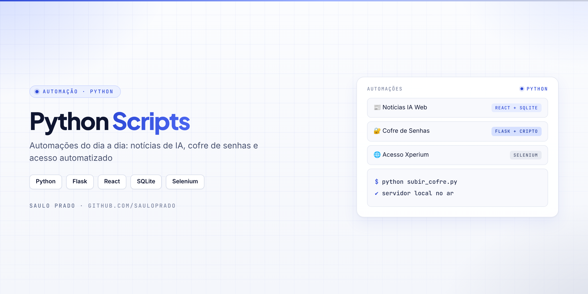
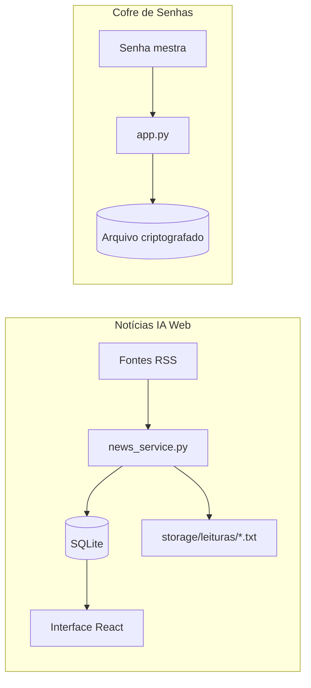

<p align="center">

</p>

<h1 align="center">Python Scripts</h1>
<p align="center"><i>Automações do dia a dia em Python: notícias de IA, cofre de senhas e acesso automatizado</i></p>

<p align="center">


</p>

## Sumário

- [Sobre](#sobre)
- [Projetos](#projetos)
- [Como funciona](#como-funciona)
- [Tecnologias](#tecnologias)
- [Como executar](#como-executar)
- [Estrutura do repositório](#estrutura-do-repositório)
- [Padrões do repositório](#padrões-do-repositório)
- [Autor](#autor)

## Sobre

Coleção de **automações reais do dia a dia**, construídas para resolver necessidades práticas e registrar a evolução técnica. Cada pasta é um projeto independente, documentado e pronto para rodar localmente.

## Projetos

| Projeto | O que faz | Stack |
| --- | --- | --- |
| [**Notícias IA Web**](Noticias%20IA%20Web/) | Busca notícias recentes sobre ChatGPT, Claude, OpenAI e Anthropic, com login local, interface React e histórico em SQLite e `.txt` | Flask · React · SQLite · RSS |
| [**Cofre de Senhas**](Cofre%20de%20Senhas/) | Cofre local com senha mestra, dados criptografados em disco e gerador de senhas fortes | Flask · cryptography |
| [**Acesso Xperium**](Acesso%20Xperium/) | Automatiza o login na plataforma Xperium: abre o navegador, preenche o formulário e registra os acessos | Selenium · WebDriver Manager |

## Como funciona



## Tecnologias

| Tecnologia | Uso |
| --- | --- |
| Python 3 | Base de todas as automações |
| Flask | Backends locais (Notícias IA e Cofre) |
| React + Vite | Frontend do Notícias IA Web |
| SQLite | Histórico das notícias |
| cryptography | Criptografia do cofre |
| Selenium + WebDriver Manager | Automação de navegador |

## Como executar

**Notícias IA Web**

```bash
# backend
cd "Noticias IA Web/backend"
pip install -r requirements.txt
python app.py

# frontend (outro terminal)
cd "Noticias IA Web/frontend"
npm install
npm run dev
```

**Cofre de Senhas** — o launcher instala as dependências, sobe o servidor e abre o navegador:

```bash
python subir_cofre.py
```

**Acesso Xperium**

```bash
pip install selenium webdriver-manager
python "Acesso Xperium/Acesso_Xperium.py"
```

## Estrutura do repositório

```text
Python-Scripts---Saulo-Prado/
├── Acesso Xperium/
│   └── Acesso_Xperium.py
├── Cofre de Senhas/
│   ├── app.py
│   ├── icon_bank.py
│   ├── requirements.txt
│   ├── static/  (app.js, styles.css)
│   └── templates/index.html
├── Noticias IA Web/
│   ├── backend/  (app.py, db.py, news_service.py, requirements.txt)
│   ├── frontend/ (React + Vite)
│   └── storage/  (db/, leituras/)
├── assets/capa.png
└── subir_cofre.py
```

## Padrões do repositório

- Objetivo claro no cabeçalho de cada script
- Uma pasta por projeto, com README próprio quando necessário
- Arquivos locais e gerados (`__pycache__/`, logs, bancos e workspaces) ficam fora do Git
- Credenciais nunca são versionadas: use `.env` a partir do `.env.example`

## Autor

**Saulo Prado** · Analista de Sistemas · Gestão de Ativos de TI, orçamento, automação e dashboards

[](https://www.linkedin.com/in/saulo-prado-ab4a0b96/)
[](https://github.com/sauloprado)
